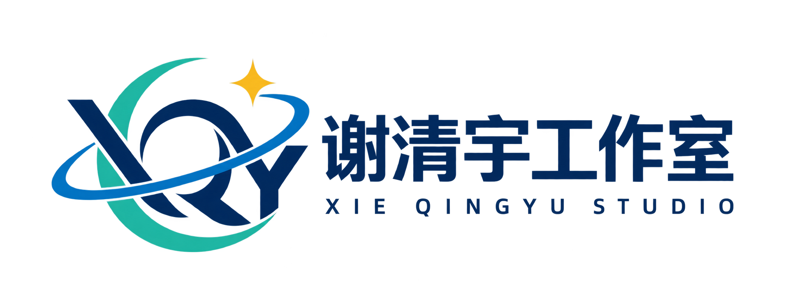

<div align="center">



# 谢清宇工作室

### AI · Agent · Dreaming

---

**探索 AI、Agent 与编程的边界，通过代码将想法转化为现实。**

</div>

---

## 👋 关于

Hi，我是**谢清宇**，一名 16 岁的 AI 从业者。

> 谢清宇工作室致力于在 AI 与自动化的交叉点探索未来。从 Agent 开发到前端设计，从 WordPress 主题到 macOS 系统工具——我们把创意变成可运行的代码。

<div align="center">

| 🏆 成就 | 📜 认证 |
|:---:|:---:|
| Agent 项目杰出贡献者 | YCL Python 六级 |
| WordPress 主题开源作者 | YCL 图形化编程四级 |
| macOS 工具与 OpenCore 实践者 | GPL 开源项目作者 |

</div>

---

## 🛠 技术栈

<div align="center">


</div>

---

## 🚀 开源项目

### [`mse-bas-tools`](https://github.com/XieQingYu-ProgramStudio/mse-bas-tools) — 月星BAS工具箱

面向 **macOS 15 / OpenCore** 环境的本地权限管理与系统维护工具，当前版本 **v1.2.1**。

<div align="left">


</div>

- 🔐 应用优先的动态 TCC 权限面板，支持中文应用名与相关权限聚合
- ⚡ 开关即时写入或删除，自动备份、事务执行、回读验证与失败回滚
- 📦 批量授权、扫描、数据库备份恢复、环境诊断和脱敏审计日志
- 🧰 系统维护：更新红点清理、EFI 分区挂载、OpenCore 主题应用与还原
- 🎥 系统测试：摄像头预览、麦克风电平、扬声器测试音和原生 TCC 授权
- 🛡️ Apple Events 精确目标保护、原子配置写入和 OpenCore 兼容性确认
- 🚀 有界并发扫描，本机 77 个应用扫描约 1.5 秒

[查看源码](https://github.com/XieQingYu-ProgramStudio/mse-bas-tools) · [下载 Release](https://github.com/XieQingYu-ProgramStudio/mse-bas-tools/releases)

---

### [`mechrevo-aurora-x-2025-efi`](https://github.com/XieQingYu-ProgramStudio/mechrevo-aurora-x-2025-efi) — 机械革命极光X 2025 OpenCore EFI

面向 **机械革命 极光 X 2025** 的 OpenCore 启动配置，已在本机 macOS 15.8.1 环境验证。

<div align="left">


</div>

- 内置显示、Wi-Fi、蓝牙、有线网络、音频、电池、键盘和 USB 可用
- 包含 OpenCore 配置、ACPI、驱动、内核扩展和谢清宇工作室 OpenCanopy 主题
- 已移除机器序列号、MLB、硬件 UUID、ROM 及 Windows 引导文件
- 内置 I2C 触控板仍无法驱动，README 中记录了当前设备路径和诊断信息
- NVIDIA 显卡依赖系统侧 NullMoth 补丁，EFI 包内不包含这些系统卷组件

[查看源码](https://github.com/XieQingYu-ProgramStudio/mechrevo-aurora-x-2025-efi) · [下载 EFI](https://github.com/XieQingYu-ProgramStudio/mechrevo-aurora-x-2025-efi/releases)

---

### [`xieqingyu-studio`](https://github.com/XieQingYu-ProgramStudio/xieqingyu-studio) — WordPress 主题

一款为创作者与工作室打造的 **Neo-Brutalism（新粗野主义）** WordPress 主题。

- 🎨 3px 粗边框 + 硬阴影 + 紫/红/黄三色系统
- 📱 响应式布局 · 粘性导航 · 自定义 Logo
- 🧩 Gutenberg 区块编辑器兼容
- 🌐 多语言就绪 · 零外部依赖 · 纯手写 CSS
- 📦 仅 ~1049 行 CSS，轻量高效

```css
/* Neo-Brutalism Design Tokens */
--primary: #6C63FF;
--accent-1: #FF6B6B;
--accent-2: #FFD93D;
--border-w: 3px;
--shadow-off: 4px;
```

---

## 🎨 设计理念

<div align="center">

**Neo-Brutalism / 新粗野主义**

粗边框 · 硬阴影 · 高饱和色彩 · 零圆角 · 大胆排版

```
┌──────────────────────────────────┐
│                                  │
│   ██╗  ██╗ ██████╗ ██╗   ██╗     │
│   ╚██╗██╔╝██╔═══██╗╚██╗ ██╔╝    │
│    ╚███╔╝ ██║   ██║ ╚████╔╝     │
│    ██╔██╗ ██║▄▄ ██║  ╚██╔╝      │
│   ██╔╝ ██╗╚██████╔╝   ██║       │
│   ╚═╝  ╚═╝ ╚══▀▀═╝    ╚═╝       │
│                                  │
│     Bold. Raw. Unapologetic.     │
│                                  │
└──────────────────────────────────┘
```

</div>

---

## 📬 联系我

<div align="center">

[](https://xieqingyu.click/)
[](https://github.com/XieQingYu-ProgramStudio)
[](https://www.youtube.com/@XieqingyuProgramStudio)
[](mailto:xieqingyu857@gmail.com)

</div>

---

<div align="center">

### 🎵 也来听听我的音乐

[](https://open.spotify.com/artist/5K8qi0Cs6KJNQxjkv7Z4Y8)

---

<sub>© 2026 Xieqingyu Program Studio · Built with passion and thick borders</sub>

</div>
